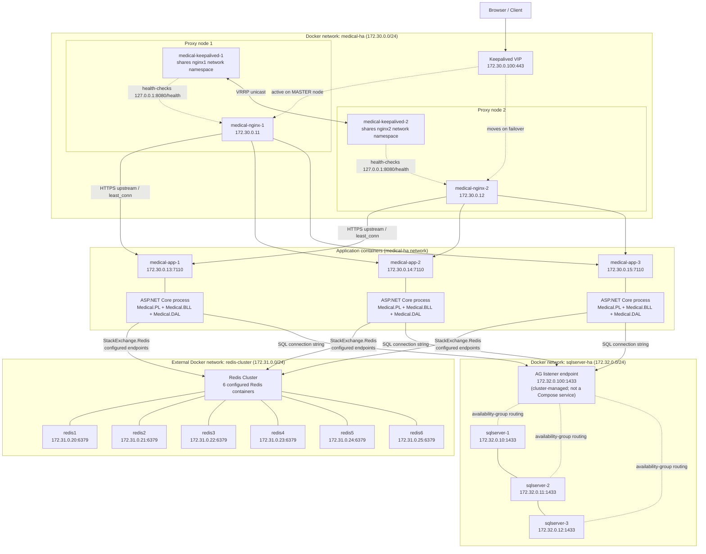
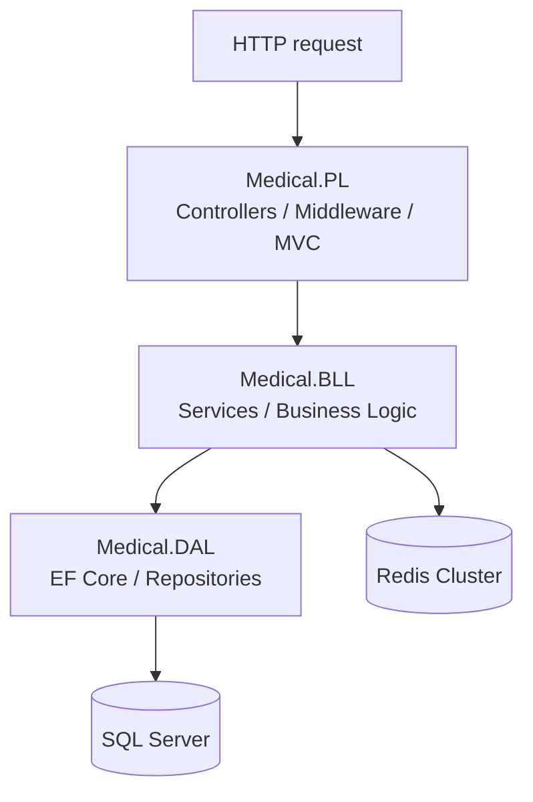
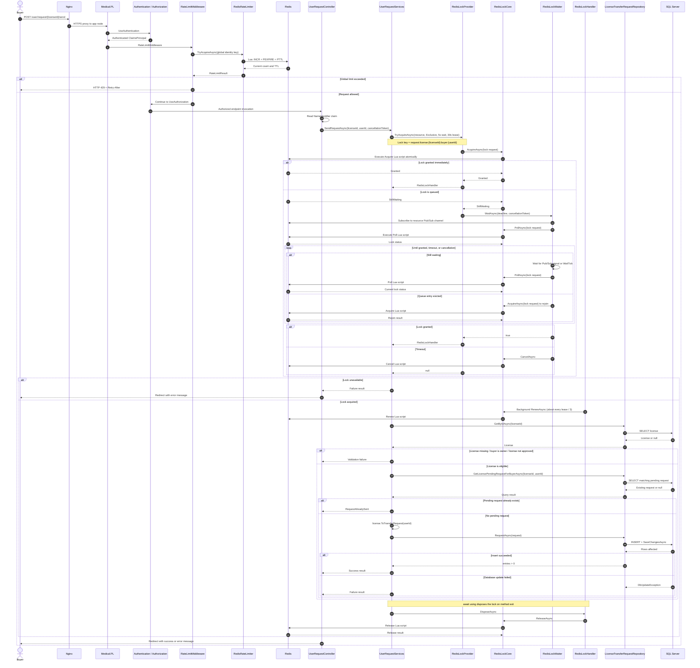

# Medical Marketplace

A containerized ASP.NET Core marketplace for managing medical product licenses, backed by SQL Server and Redis, with a distributed infrastructure lab built around high availability, load balancing, and shared application state.

> **Project status:** Active development. The repository contains the application, infrastructure definitions, custom infrastructure components, and manually triggered GitHub Actions workflows that build and publish container images to GitHub Container Registry (GHCR). The infrastructure is a hands-on deployment project; a complete, one-command production deployment is not currently documented or guaranteed.

## Overview

Medical is designed around a layered ASP.NET Core application and a distributed runtime:

- **Medical.PL** — ASP.NET Core MVC presentation layer.
- **Medical.BLL** — business logic and application services.
- **Medical.DAL** — Entity Framework Core persistence, repositories, and Identity integration.
- **SQL Server** — relational persistence, with a three-node Always On availability-group / Pacemaker-based HA environment.
- **Redis Cluster** — distributed cache, locking, rate limiting, and shared ASP.NET Core Data Protection keys.
- **Nginx + Keepalived** — reverse proxy, application load balancing, health checks, and a virtual IP failover setup.
- **GitHub Actions + GHCR** — manually triggered container builds and image publishing.

## Architecture

The intended request path is:

```text
                         Client / Browser
                                |
                         Public or LAN VIP
                                |
                     Keepalived (VRRP failover)
                                |
                     +----------+----------+
                     |                     |
                  Nginx 1               Nginx 2
                     |                     |
                     +----------+----------+
                                |
                     Nginx upstream pool
                       (least connections)
                                |
               +----------------+----------------+
               |                |                |
          Medical App 1    Medical App 2    Medical App 3
               |                |                |
               +----------------+----------------+
                                |
                  +-------------+-------------+
                  |                           |
             SQL Server HA                Redis Cluster
          (3 SQL Server nodes)        (6 Redis nodes in the
          Pacemaker / Corosync         current Compose file)
          Always On availability
                  |
             MedicalDB
```

The application nodes are intended to be stateless with shared state provided by SQL Server and Redis. Redis is used for distributed application concerns; SQL Server remains the primary relational data store.

### Infrastructure Diagrams

These diagrams are rendered by GitHub directly from Mermaid source and are based on the current Docker Compose files, Nginx/Keepalived configuration, ASP.NET Core startup pipeline, and the transfer-request implementation.

#### 1. Container and network topology



**Application container internals:** each of the three application containers runs one ASP.NET Core process. The three projects are application layers, not separate containers:



The BLL Redis integrations include the custom distributed cache, distributed lock, and distributed rate limiter. Redis also stores the shared ASP.NET Core Data Protection key ring. The SQL endpoint shown above is the address configured in the application connection string; it is expected to be provided by the SQL Server HA/availability-group setup, not by a Compose-defined listener container.

#### 2. Sequence: submit a license transfer request

This sequence follows `UserRequestController.SendRequest`, `UserRequestServices.SendRequestAsync`, the Redis lock provider/core/waiter/handler, and `LicenseTransferRequestRepository`.

The request is authenticated before the rate-limit middleware runs. The middleware applies the global Redis rate-limit policy; authorization then runs before the `[Authorize]` controller action is invoked.



**Implementation details represented above:**

- The send-request lock is exclusive and scoped to `request:license:{licenseId}:buyer:{userId}`.
- The lock acquisition waits up to 5 seconds and requests a 30-second lease.
- `RedisLockCore` executes the lock Lua scripts; `RedisLockWaiter` handles Pub/Sub wake-ups, polling, timeout, cancellation, and queue re-entry.
- `RedisLockHandler` renews the lease at approximately one-third of its duration and releases it during asynchronous disposal.
- The service checks that the license exists, is not owned by the buyer, is approved, and has no existing pending request from that buyer before inserting the transfer request.
- The current lock key serializes submissions by the same buyer for the same license. It does not serialize different buyers submitting requests for that same license.

**Diagram scope:** these diagrams describe the repository's configured topology and code path. Compose files define the containers and networks, but Redis Cluster formation and SQL Server HA/availability-group initialization are separate operational steps. A container diagram does not imply that those clusters are currently initialized or healthy.

### Infrastructure components

| Component | Repository location | Purpose |
|---|---|---|
| ASP.NET Core application | `Medical.PL/`, `Medical.BLL/`, `Medical.DAL/` | Marketplace web application |
| Application container | `Dockerfile` | Multi-stage .NET 10 build and runtime image |
| SQL Server base image | `Infrastructure/SqlServerBase/` | SQL Server 2025 installation and first-start setup |
| SQL Server HA image and cluster | `Infrastructure/SqlServerHaCluster/` | Pacemaker, Corosync, PCS, SQL Server HA packages, and Docker fencing agent |
| Redis Cluster | `Infrastructure/RedisCluster/` | Six Redis 7.4 nodes with cluster mode and AOF persistence |
| Nginx / Keepalived | `Infrastructure/NginxKeepalived/` | Reverse proxy, upstream load balancing, health checks, and VRRP VIP |
| Application deployment | `Infrastructure/MedicalApps/` | Three application service definitions |
| CI image builds | `.github/workflows/` | Manual image build and push workflows |

## Application stack

- .NET 10 / ASP.NET Core MVC
- C#
- Entity Framework Core
- SQL Server 2025
- ASP.NET Core Identity
- Google external authentication
- Redis 7.4 / StackExchange.Redis
- Docker and Docker Compose
- Nginx
- Keepalived / VRRP
- Pacemaker / Corosync / PCS
- GitHub Actions
- GitHub Container Registry

## Application design

The solution is separated into three projects:

```text
Medical.slnx
├── Medical.PL/
│   └── ASP.NET Core MVC, middleware, controllers, views, and composition root
├── Medical.BLL/
│   └── Business services, application rules, and infrastructure abstractions
└── Medical.DAL/
    └── EF Core context, Identity, repositories, and persistence
```

The application uses:

- ASP.NET Core Identity for user authentication and role-based authorization.
- Google authentication for external sign-in.
- Entity Framework Core with SQL Server for persistence.
- Repository and service abstractions to separate persistence from business logic.
- Redis-backed distributed cache.
- Redis-backed distributed locking.
- Redis-backed rate limiting middleware.
- Redis-backed ASP.NET Core Data Protection key persistence, allowing application instances to share authentication-related protection keys.
- Forwarded-header processing for requests received through the Nginx proxies.

### Marketplace domain

The application is focused on medical product licenses and their lifecycle, including license management and ownership-transfer workflows. The domain includes product/license records, user profiles, administrative review, and transfer requests.

## Distributed infrastructure details

### SQL Server HA

The SQL Server infrastructure is split into two image layers:

1. **Base image** — installs SQL Server 2025, command-line tools, and a first-start systemd service.
2. **HA image** — extends the base image with Pacemaker, Corosync, PCS, `mssql-server-ha`, and a custom Docker STONITH fencing agent.

The current SQL Server Compose definition describes three SQL Server containers with separate persistent data directories and addresses on the `sqlserver-ha` Docker network. Cluster creation, Always On configuration, fencing setup, and resource management require additional cluster initialization and configuration steps; building the image alone does not configure an operational availability group.

### Redis Cluster

The Redis Compose definition describes six Redis 7.4 nodes. Each node:

- Runs with Redis Cluster enabled.
- Uses a dedicated data directory.
- Announces its configured cluster IP and ports.
- Enables AOF persistence with `appendfsync everysec`.

The application reads Redis endpoints from its configuration section and creates a shared StackExchange.Redis connection multiplexer.

**Topology note:** the current Redis Compose file places all six nodes on one Docker network. This is useful for cluster development and functional testing, but it does not provide host-level fault isolation. For infrastructure-level HA, distribute Redis nodes across independent hosts or failure domains and configure networking and announced addresses accordingly.

### Nginx and Keepalived

The proxy layer contains two Nginx instances and two Keepalived instances:

- Nginx distributes requests across three application nodes using the `least_conn` balancing method.
- Each Nginx instance exposes a local health endpoint used by Keepalived.
- Keepalived uses VRRP with a preferred MASTER and BACKUP node and a virtual IP configured as `172.30.0.100/24`.

The configured addresses are private Docker-network addresses. They are not automatically public internet addresses. VIP behavior also depends on the host network and the environment's support for the required networking capabilities.

## Container images

The repository's GitHub Actions workflows publish these images to GHCR:

| Image | Tag | Built from |
|---|---|---|
| `ghcr.io/zeyadeltaher/medical-app` | `latest` | Root `Dockerfile` |
| `ghcr.io/zeyadeltaher/sqlserver` | `2025` | `Infrastructure/SqlServerBase/Dockerfile` |
| `ghcr.io/zeyadeltaher/sqlserver-ha` | `2025` | `Infrastructure/SqlServerHaCluster/Dockerfile` |

Pull an image:

```bash
docker pull ghcr.io/zeyadeltaher/medical-app:latest
docker pull ghcr.io/zeyadeltaher/sqlserver:2025
docker pull ghcr.io/zeyadeltaher/sqlserver-ha:2025
```

If a package is private, authenticate to GHCR before pulling:

```bash
docker login ghcr.io
```

Use a GitHub credential with permission to read packages. Do not put credentials directly in shell commands, Dockerfiles, Compose files, or this README.

## CI workflows

Two GitHub Actions workflows are available. Both use `workflow_dispatch`, so they run manually rather than on every push.

| Workflow | File | Output |
|---|---|---|
| Build Medical App Image | `.github/workflows/build-medical-app.yml` | `medical-app:latest` |
| Build SQL Server HA Images | `.github/workflows/build-sqlserver-ha.yml` | `sqlserver:2025` and `sqlserver-ha:2025` |

To run a workflow:

1. Open the repository's **Actions** tab.
2. Select the workflow.
3. Choose **Run workflow** on the `master` branch.
4. Wait for the build and GHCR push steps to complete.

The SQL Server workflow builds and pushes the base SQL Server image before building the HA image, because the HA Dockerfile uses `FROM sqlserver:2025`.

The workflows use the repository-provided `GITHUB_TOKEN` with `packages: write`. The target GHCR packages must grant the workflow repository the required Actions access.

## Configuration and secrets

Configuration is supplied through environment variables and configuration providers. Example templates are provided for the application and SQL Server images:

- `Infrastructure/MedicalApps/.env.example`
- `Infrastructure/SqlServerBase/secrets/sqlserver.env.example`
- `Infrastructure/SqlServerHaCluster/secrets/sqlserver.env.example`

Create local environment files from the relevant templates and replace every placeholder with an appropriate value. Keep the real files out of version control.

The application deployment expects configuration for:

- HTTPS certificate password and certificate files.
- Google OAuth client ID and client secret.
- Initial administrator username, email, and password.
- SQL Server connection credentials.

The SQL Server containers expect SQL Server environment configuration and secrets. The HA environment also requires the cluster authentication password.

### Secret-handling rules

- Never commit real `.env` files, passwords, OAuth secrets, private keys, or certificates.
- Do not use the example placeholder values in a running deployment.
- Rotate any credential that has been exposed publicly.
- Restrict access to Docker Engine APIs and cluster-management ports.
- Use TLS and network controls for traffic crossing host boundaries.

## Deployment notes

The Compose files describe separate infrastructure components and use shared external Docker networks. They are not a single self-contained Compose deployment.

Before starting the application stack, ensure that:

1. The required Docker networks exist.
2. SQL Server nodes are initialized and the SQL Server HA resources and availability group are configured.
3. The Redis nodes are started and joined into a Redis Cluster.
4. The Nginx certificates and configuration are in place.
5. The Keepalived VIP is valid for the host networking environment.
6. The application environment file contains valid configuration and the SQL Server and Redis endpoints are reachable.

The application Compose file currently declares a build path of `Medical.PL/Dockerfile`, while the repository's application Dockerfile is at the repository root. The published application image is built by the root Dockerfile through the GitHub Actions workflow. If building the application directly with Compose, align the Compose `dockerfile` setting with the root Dockerfile, or add the intended project-level Dockerfile before running that build.

The SQL Server and Redis Compose definitions currently use containerized nodes on Docker networks. A production HA deployment needs independent hosts/failure domains, persistent storage, appropriate cluster networking, secure fencing, backups, monitoring, and tested recovery procedures.

## Local development

For application development, use the .NET 10 SDK and provide reachable SQL Server and Redis instances with the required configuration.

Check the installed SDK:

```bash
dotnet --info
```

Restore and build the solution:

```bash
dotnet restore Medical.slnx
dotnet build Medical.slnx
```

Run the web application:

```bash
dotnet run --project Medical.PL/Medical.PL.csproj
```

The application requires a valid SQL Server connection string and Redis endpoint configuration. It also configures HTTPS-oriented authentication cookies and Google authentication, so local development settings and callback URLs must be configured appropriately.

## Scope and limitations

This repository combines an application project with an infrastructure engineering environment. Some infrastructure operations require explicit initialization and validation beyond Docker image creation.

In particular:

- A successful Docker image build does not mean the SQL Server availability group or Redis Cluster has been initialized.
- Three SQL Server containers on one Docker host do not protect against host failure.
- Six Redis containers on one Docker host do not provide host-level high availability.
- A Docker bridge VIP is not automatically reachable from outside the Docker host.
- The current Compose files depend on external networks and environment files.
- The current application Compose build path needs to be aligned with the root Dockerfile if Compose-based builds are used.

Treat the current configuration as a development and infrastructure-lab baseline, not as a production-ready deployment recipe.

## License

This project is licensed under the [MIT License](LICENSE).
